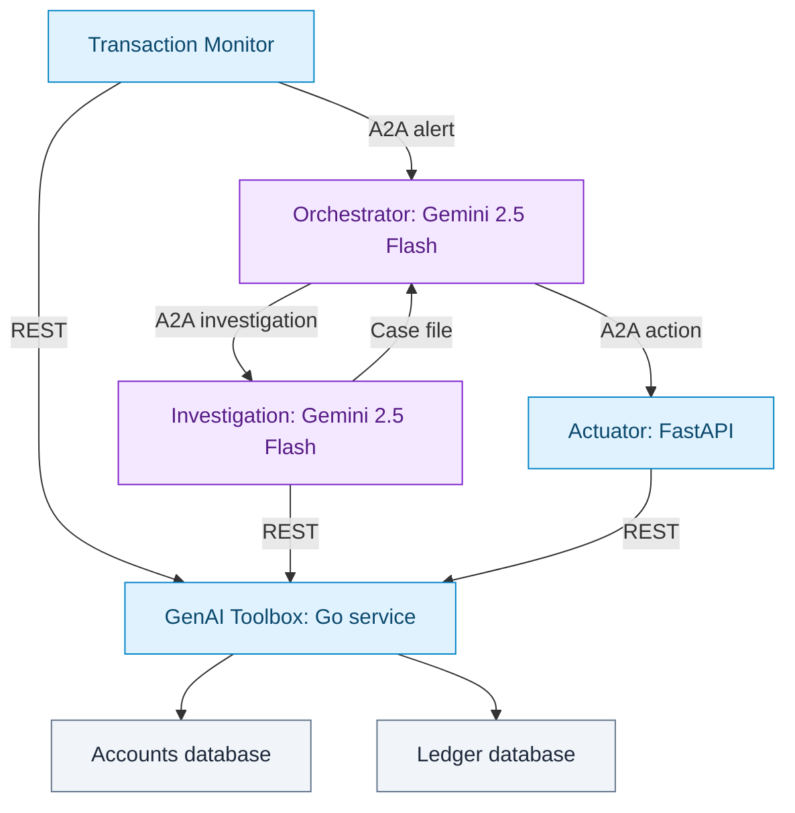

# Vigil AI Fraud Shield

[](vigil-system/orchestrator_agent/Dockerfile) [](https://fastapi.tiangolo.com/) [](https://cloud.google.com/kubernetes-engine) [](vigil-system/investigation_agent/agent.py) [](LICENSE)

Hackathon prototype that monitors [Bank of Anthos](https://github.com/GoogleCloudPlatform/bank-of-anthos) transactions on GKE and uses Gemini with predefined SQL tools to assess fraud risk without patching the banking app. Received an [honorable mention](https://cloud.google.com/blog/topics/developers-practitioners/winners-and-highlights-from-gke-hackathon) at the GKE Turns 10 Hackathon 2025 ([demo video](https://www.youtube.com/watch?v=S7xQgOoeFOw)).



## Deployment

Manifests preserve the hackathon environment and run from the repository root with Bash, `docker`, `gcloud`, and `kubectl` configured against the target cluster.

Prerequisites:

- Billed GCP project with a GKE cluster able to pull from Artifact Registry.
- Bank of Anthos running in the same namespace.
- Reconciled database hosts, credentials, and SQL in [toolbox-configmap.yaml](vigil-system/genal_toolbox/toolbox-configmap.yaml) (Kubernetes mounts this ConfigMap over the image's `tools.yaml`, so edit the ConfigMap rather than `tools.yaml`).

> [!WARNING]
> Before deploying, reconcile [actuator](vigil-system/actuator_agent/agent.py) and `lock_account` in `toolbox-configmap.yaml`: the actuator sends `account_id`, while `lock_account` expects `ext_user_id` and writes `ACCOUNT_LOCKED_BY_VIGIL` to `users.user_info`.

### Configure credentials and registry

Copy the secret template, set your `GEMINI_API_KEY` (the generated file stays untracked in Git), and create the Artifact Registry repository:

```bash
cp vigil-system/gemini-api-key-secret.yaml.example vigil-system/gemini-api-key-secret.yaml

export VIGIL_PROJECT_ID="$(gcloud config get-value project)"
export VIGIL_REGION="us-central1"
export VIGIL_REPO="vigil-repo"
export VIGIL_IMAGE_PREFIX="${VIGIL_REGION}-docker.pkg.dev/${VIGIL_PROJECT_ID}/${VIGIL_REPO}"
export VIGIL_IMAGE_TAG="$(git rev-parse --short HEAD)"

gcloud artifacts repositories create "$VIGIL_REPO" \
    --repository-format=docker --location="$VIGIL_REGION"
gcloud auth configure-docker "${VIGIL_REGION}-docker.pkg.dev"
```

### Build and push images

Toolbox and Investigation use their own subdirectories as build contexts; the other three expect the repository root:

```bash
docker build -t "${VIGIL_IMAGE_PREFIX}/genal-toolbox:${VIGIL_IMAGE_TAG}" vigil-system/genal_toolbox
docker build -t "${VIGIL_IMAGE_PREFIX}/investigation-agent:${VIGIL_IMAGE_TAG}" vigil-system/investigation_agent
docker build -t "${VIGIL_IMAGE_PREFIX}/transaction-monitor-agent:${VIGIL_IMAGE_TAG}" -f vigil-system/transaction_monitor_agent/Dockerfile .
docker build -t "${VIGIL_IMAGE_PREFIX}/orchestrator-agent:${VIGIL_IMAGE_TAG}" -f vigil-system/orchestrator_agent/Dockerfile .
docker build -t "${VIGIL_IMAGE_PREFIX}/actuator-agent:${VIGIL_IMAGE_TAG}" -f vigil-system/actuator_agent/Dockerfile .

for image in genal-toolbox investigation-agent transaction-monitor-agent orchestrator-agent actuator-agent; do
    docker push "${VIGIL_IMAGE_PREFIX}/${image}:${VIGIL_IMAGE_TAG}"
done
```

### Apply manifests

Apply the secret, Toolbox ConfigMap, services, and deployments with updated local image fields:

```bash
kubectl apply -f vigil-system/gemini-api-key-secret.yaml
kubectl apply -f vigil-system/genal_toolbox/toolbox-configmap.yaml
for service in vigil-system/*/*_service.yaml; do
    kubectl apply -f "$service"
done

set -euo pipefail
for component in genal_toolbox transaction_monitor_agent orchestrator_agent investigation_agent actuator_agent; do
    image="${component//_/-}"
    kubectl set image --local \
        -f "vigil-system/${component}/${component}_deployment.yaml" \
        "${image}=${VIGIL_IMAGE_PREFIX}/${image}:${VIGIL_IMAGE_TAG}" -o yaml |
        kubectl apply -f -
done
```

Key environment variables across deployments:

| Variable | Component | Default |
| --- | --- | --- |
| `FRAUD_THRESHOLD` | Transaction Monitor | `1000.0` (strict `>`) |
| `POLL_INTERVAL` | Transaction Monitor | `5` seconds |
| `RISK_SCORE_THRESHOLD` | Orchestrator | `7` (inclusive `>=`) |
| `GEMINI_API_KEY` | Orchestrator and Investigation | Required via `gemini-api-key` secret |

## Architecture and decisions

The [monitor](vigil-system/transaction_monitor_agent/agent.py) polls every 5 seconds for transactions above `FRAUD_THRESHOLD`, triggers an A2A investigation by the [investigator](vigil-system/investigation_agent/agent.py), and lets the [orchestrator](vigil-system/orchestrator_agent/agent.py) escalate to the [actuator](vigil-system/actuator_agent/agent.py).

| Decision | Rationale and implementation |
| --- | --- |
| Out-of-band polling | Keeps detection off Bank of Anthos's request path, trading polling delay and cursor state for zero app patches |
| Fixed SQL tools over MCP | Exposes named queries at `/api/tool/<tool>/invoke` from [toolbox-configmap.yaml](vigil-system/genal_toolbox/toolbox-configmap.yaml) so agents never generate SQL |
| Fixed context collection | Investigator fetches the account profile and last 50 outgoing transactions via fixed queries, then asks Gemini (`gemini-2.5-flash` via Google ADK) for a 0 to 10 risk score |
| LLM assessment vs deterministic actuation | Orchestrator delegates over A2A; the FastAPI actuator calls `lock_account` without an LLM |
| Fallback escalation | Python triggers fallback actuation when a parsed score meets `RISK_SCORE_THRESHOLD` without a recorded actuator call; below-threshold model calls still execute and get logged |

## Inspecting a run

```bash
kubectl get pods
kubectl logs -f deployment/transaction-monitor-agent
kubectl logs -f deployment/orchestrator-agent
kubectl logs -f deployment/investigation-agent
kubectl logs -f deployment/actuator-agent
```

- Action verification: confirm `lock_account` by inspecting the actuator's returned status and resulting database row rather than the orchestrator's narrative response or HTTP `200`.
- Health endpoints: `/health` on the three FastAPI agents reports process liveness only, not database or Gemini connectivity.

## Limitations

- Ephemeral state: monitor cursor, ADK sessions, and the shared case-file cache live in memory; polling starts at startup time and concurrent alerts share the cache without isolation.
- Unpinned builds: Python requirements are unpinned and the Toolbox Dockerfile clones its upstream repo without a fixed commit, so rebuilds can drift from the demo.
- Unimplemented controls: there is no automated test suite, measured fraud-detection accuracy, human-approval gate, false-positive feedback loop, or distributed tracing.

## License

[MIT](LICENSE).
