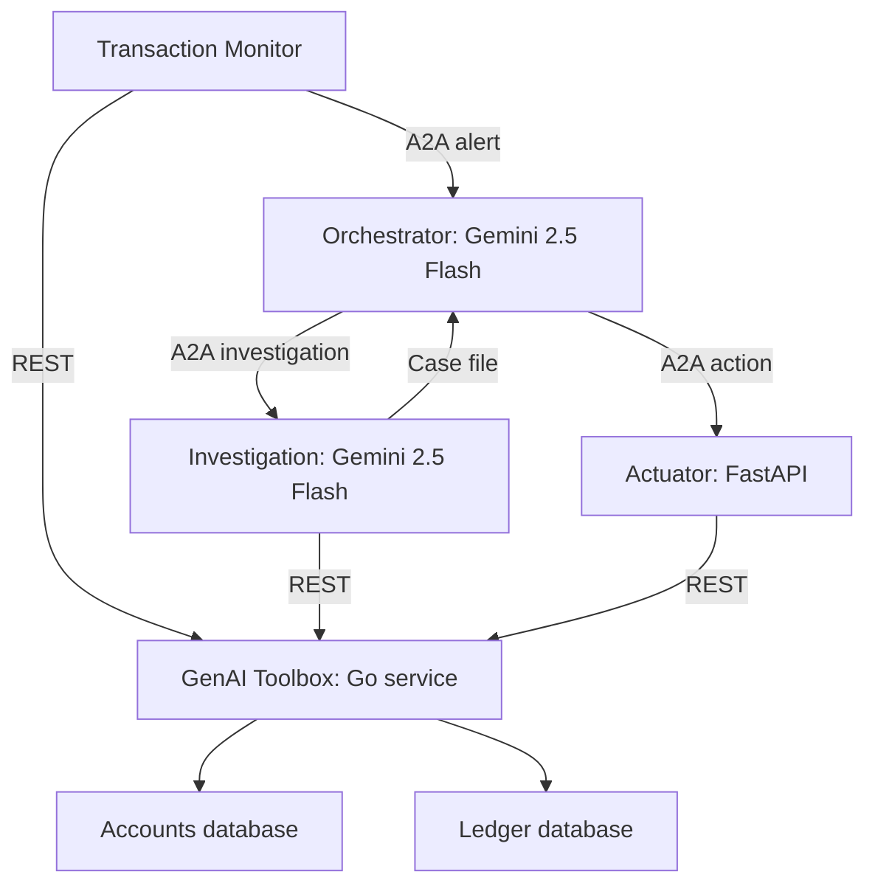

# Vigil AI Fraud Shield

[](vigil-system/orchestrator_agent/Dockerfile) [](https://fastapi.tiangolo.com/) [](https://cloud.google.com/kubernetes-engine) [](vigil-system/investigation_agent/agent.py) [](LICENSE)

Vigil is a hackathon prototype that monitors transactions in [Bank of Anthos](https://github.com/GoogleCloudPlatform/bank-of-anthos), gathers account context and uses Gemini to assess fraud risk. Four agents run on GKE: a transaction monitor, an orchestrator, an investigator and an actuator. They interact with the banking application's databases through predefined SQL tools without patching its application code.

Built for the GKE Turns 10 Hackathon 2025, where it received an [honorable mention](https://cloud.google.com/blog/topics/developers-practitioners/winners-and-highlights-from-gke-hackathon). [Watch the demo](https://www.youtube.com/watch?v=S7xQgOoeFOw).

## Architecture



The [monitor](vigil-system/transaction_monitor_agent/agent.py) polls every 5 seconds by default and sends alerts for amounts strictly above `FRAUD_THRESHOLD` (default `1000.0`). The [investigator](vigil-system/investigation_agent/agent.py) fetches the account profile and the 50 most recent outgoing transactions before asking Gemini for a JSON risk score from 0 to 10 and a justification. The [orchestrator](vigil-system/orchestrator_agent/agent.py) delegates the investigation, reviews the case file and can ask the [actuator](vigil-system/actuator_agent/agent.py) to invoke `lock_account`.

## Technical decisions

Polling keeps transaction detection outside the banking application's request path. The monitor uses an amount threshold to decide which transactions reach the LLM workflow, rather than sending every transaction for analysis. This introduces a polling delay and depends on the monitor's timestamp cursor.

Orchestration and investigation use Google ADK `LlmAgent` with `gemini-2.5-flash`. Context collection in the investigator follows fixed database calls; Gemini produces the assessment from that context. The orchestrator exposes delegation as function tools backed by A2A messages, while the actuator executes the supported action without an LLM. This separates assessment from the database operation that changes account state.

Agent communication uses A2A message types over FastAPI endpoints. Database operations use the Toolbox REST interface at `/api/tool/<tool>/invoke`, not MCP. The SQL statements and parameters are declared in [the Toolbox configuration](vigil-system/genal_toolbox/toolbox-configmap.yaml), so agents select named operations rather than generate SQL.

The intended escalation boundary is `risk_score >= RISK_SCORE_THRESHOLD`, with a default of 7. The orchestrator prompt requests investigation before actuation, and Python code attempts fallback actuation when a parsed score meets the threshold but no successful actuator response was recorded. The response includes `tool_events`, the case file and the action result for inspection. The threshold is not a hard guard on every model-initiated actuator call; a below-threshold call can execute and is logged afterward.

## Deployment

The manifests preserve the hackathon environment's settings. Deployment requires a Google Cloud project with billing, a GKE cluster, Docker, authenticated `gcloud` and `kubectl`, and Bank of Anthos already running in the same namespace. The cluster must be able to pull from Artifact Registry. The shell examples use Bash and run from this repository's root with the intended project and Kubernetes context selected.

Before deployment, align the database hosts, credentials and SQL with the running Bank of Anthos schema. In particular, the actuator sends `account_id`, but the supplied `lock_account` tool declares `ext_user_id`; reconcile this contract before exercising the action. Its SQL writes `ACCOUNT_LOCKED_BY_VIGIL` into `users.user_info`, so the effect of that marker on the banking application's behavior also needs verification. Kubernetes mounts `toolbox-configmap.yaml` over the image's `tools.yaml`; the ConfigMap is the configuration used by these manifests.

### Configure credentials and images

Copy the Gemini secret example and replace its placeholder with the API key:

```bash
cp vigil-system/gemini-api-key-secret.yaml.example vigil-system/gemini-api-key-secret.yaml
```

The generated secret file is ignored by Git. Set the registry location and image tag:

```bash
export VIGIL_PROJECT_ID="$(gcloud config get-value project)"
export VIGIL_REGION="us-central1"
export VIGIL_REPO="vigil-repo"
export VIGIL_IMAGE_PREFIX="${VIGIL_REGION}-docker.pkg.dev/${VIGIL_PROJECT_ID}/${VIGIL_REPO}"
export VIGIL_IMAGE_TAG="$(git rev-parse --short HEAD)"
```

Create the Artifact Registry repository if it does not exist, then configure Docker authentication:

```bash
gcloud artifacts repositories create "$VIGIL_REPO" \
    --repository-format=docker --location="$VIGIL_REGION"
gcloud auth configure-docker "${VIGIL_REGION}-docker.pkg.dev"
```

### Build and push images

The Toolbox and investigator Dockerfiles expect their own directories as build contexts. The other three expect the repository root:

```bash
docker build -t "${VIGIL_IMAGE_PREFIX}/genal-toolbox:${VIGIL_IMAGE_TAG}" vigil-system/genal_toolbox
docker build -t "${VIGIL_IMAGE_PREFIX}/investigation-agent:${VIGIL_IMAGE_TAG}" vigil-system/investigation_agent
docker build -t "${VIGIL_IMAGE_PREFIX}/transaction-monitor-agent:${VIGIL_IMAGE_TAG}" -f vigil-system/transaction_monitor_agent/Dockerfile .
docker build -t "${VIGIL_IMAGE_PREFIX}/orchestrator-agent:${VIGIL_IMAGE_TAG}" -f vigil-system/orchestrator_agent/Dockerfile .
docker build -t "${VIGIL_IMAGE_PREFIX}/actuator-agent:${VIGIL_IMAGE_TAG}" -f vigil-system/actuator_agent/Dockerfile .

for image in genal-toolbox investigation-agent transaction-monitor-agent orchestrator-agent actuator-agent; do
    docker push "${VIGIL_IMAGE_PREFIX}/${image}:${VIGIL_IMAGE_TAG}"
done
```

### Apply manifests

Apply the secret, reconciled Toolbox configuration and services. The standalone `tools.yaml` is Toolbox input, not a Kubernetes resource, so it is not included in these commands:

```bash
kubectl apply -f vigil-system/gemini-api-key-secret.yaml
kubectl apply -f vigil-system/genal_toolbox/toolbox-configmap.yaml
for service in vigil-system/*/*_service.yaml; do
    kubectl apply -f "$service"
done
```

The checked-in deployments reference images from the original project. [Render their image fields locally](https://kubernetes.io/docs/reference/kubectl/generated/kubectl_set/kubectl_set_image/) before applying them, using the registry and tag set above:

```bash
set -euo pipefail
for component in genal_toolbox transaction_monitor_agent orchestrator_agent investigation_agent actuator_agent; do
    image="${component//_/-}"
    kubectl set image --local \
        -f "vigil-system/${component}/${component}_deployment.yaml" \
        "${image}=${VIGIL_IMAGE_PREFIX}/${image}:${VIGIL_IMAGE_TAG}" -o yaml |
        kubectl apply -f -
done
```

| Variable | Component | Default |
|---|---|---|
| `FRAUD_THRESHOLD` | Transaction Monitor | `1000.0`, strict amount comparison |
| `POLL_INTERVAL` | Transaction Monitor | `5` seconds |
| `RISK_SCORE_THRESHOLD` | Orchestrator | `7`, inclusive escalation threshold |
| `GEMINI_API_KEY` | Orchestrator and Investigation | Required through the `gemini-api-key` secret |

## Inspecting a run

```bash
kubectl get pods
kubectl logs -f deployment/transaction-monitor-agent
kubectl logs -f deployment/orchestrator-agent
kubectl logs -f deployment/investigation-agent
kubectl logs -f deployment/actuator-agent
```

For a transaction above the amount threshold, inspect the alert, investigation case file, numeric score and any actuator call. Check the actuator's returned status and the resulting database state, rather than treating a narrative summary or HTTP success as proof that the action succeeded. The three FastAPI agents expose `/health`, which reports process availability rather than an end-to-end database or Gemini check.

## Limitations

The monitor cursor, ADK sessions and cached case file are held in memory. The cursor starts at the current time when the monitor starts; durable event handling and isolation of the shared case-file cache between concurrent alerts are not implemented.

Python dependencies are unpinned, and the Toolbox Dockerfile clones its upstream repository without fixing a revision. Rebuilding can therefore produce a different dependency set from the demo. This repository contains no automated test suite or measured fraud-detection accuracy. Human approval, false-positive feedback and distributed tracing remain possible extensions, not implemented behavior.

## License

[MIT](LICENSE).
